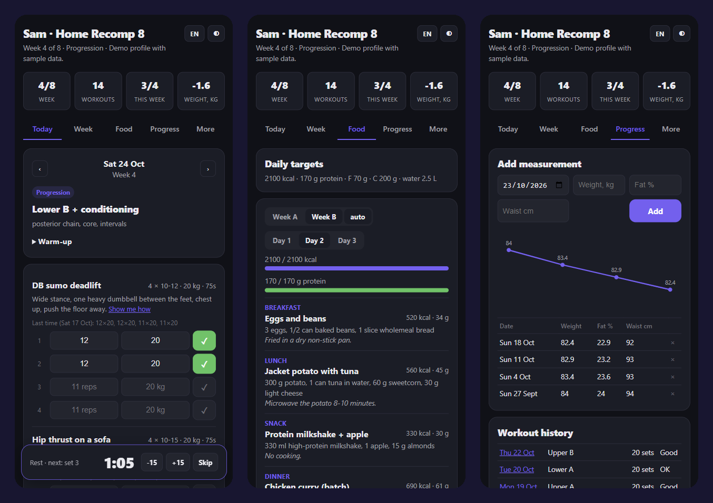

# personal-coach-kit

**Свой ИИ-тренер и нутрициолог примерно за 15 минут.** Отвечаете на короткую анкету, любая нейросеть (Claude, ChatGPT, Gemini или локальная модель) пишет программу тренировок и рацион из того магазина, где вы реально покупаете продукты. Дальше тренируетесь с трекером: таймер отдыха, интервальный таймер, список покупок, графики замеров. По желанию Telegram-бот напоминает, спрашивает, как прошла тренировка, и шутит в том характере, который вы выберете.

[English](README.md) · **[Демо](https://personal-coach-kit.pages.dev/ru/)** (вымышленный профиль) · [Demo in English](https://personal-coach-kit.pages.dev)



## Проще всего: отдать своему ИИ-агенту

Если у вас Claude Code (или другой агент, который умеет запускать команды: Codex, Cursor, Claude Cowork), вставьте ему это сообщение и просто отвечайте на вопросы:

```
Склонируй https://github.com/devladpopov/personal-coach-kit в папку personal-coach в моей домашней папке (если нет git, скачай zip), перейди в неё и выполни .claude/skills/coach/SKILL.md: будь моим персональным тренером и нутрициологом.
```

Агент проверит Node.js, проведёт интервью, сам напишет программу и рацион (ключ API не нужен), проверит их, откроет трекер и даст ссылку для телефона. Публикацию сайта и Telegram-бота он предложит отдельными шагами по желанию. Потом возвращайтесь в ту же папку и говорите «болит колено на выпадах», «вот мои замеры», «сделай следующий блок»: агент продолжит вести вас как тренер.

## Установка и запуск одной командой

```bash
git clone https://github.com/devladpopov/personal-coach-kit && cd personal-coach-kit && node coach.mjs init
```

Нужен только Node.js 18+. Без `npm install`, без зависимостей, без базы данных и регистрации.

Дальше:

```bash
node coach.mjs generate   # нейросеть пишет data/program.json и data/meals.json
node coach.mjs serve      # открыть http://localhost:8080
```

Сначала посмотреть, как это выглядит: `node coach.mjs demo --ru && node coach.mjs serve` загрузит русский демо-профиль.

## Что получается

```
Анкета       цели, рост и вес, дни и минуты, инвентарь, травмы,
             что любите и не едите, магазин и бюджет на неделю
Программа    сплит на 7 дней на N недель, фазы, правило прогрессии,
             подсказки по технике, замены при травмах, разминка, заминка
Рацион       калории и белок, недели A/B по 3 меню на день,
             список покупок под ваш магазин с ценами, добавки
Трекер       повторы и вес в каждом подходе, «в прошлый раз»,
             автотаймер отдыха со звуком, интервальный таймер,
             неделя, чек-лист покупок, график веса, жира и талии,
             RU/EN, тёмная и светлая тема, удобно с телефона
Telegram-бот утром план и меню, напоминание перед тренировкой,
             вечером «тренировались?», в субботу список покупок,
             в воскресенье взвешивание, /done /skip /weight /stats /pause
```

## Подключите свою нейросеть

Весь «мозг» тренера лежит в одном файле: [`prompts/coach.md`](prompts/coach.md). Поменяйте его, и тренер начнёт думать иначе. Команда `generate` отправляет промпт вместе с `data/profile.json` тому провайдеру, который указан в `.env` (скопируйте `.env.example`):

```
Провайдер       .env                         Модель по умолчанию
Claude          ANTHROPIC_API_KEY=...        claude-sonnet-5
ChatGPT         OPENAI_API_KEY=...           gpt-5
Gemini          GEMINI_API_KEY=...           gemini-2.5-flash
Локально        COACH_PROVIDER=ollama        qwen2.5:14b
Любой OpenAI-совместимый адрес (OpenRouter, LM Studio, vLLM): OPENAI_BASE_URL
Другая модель: COACH_MODEL=...   или   --model ...
```

Нет ключа API? `node coach.mjs prompt`, вставьте `data/prompt.txt` в любой чат, сохраните ответ в файл и выполните `node coach.mjs import answer.txt`. Ответ проверяется (7 дней, подходы и повторы, меню, список покупок), а если модель ошиблась, вы увидите понятный список ошибок. `generate` один раз сам просит модель исправиться.

Работаете в Claude Code? Откройте репозиторий и скажите «будь моим тренером»: встроенный скилл (`.claude/skills/coach`) проведёт интервью и сам запишет файлы, ключ не нужен. Правили файлы руками? `node coach.mjs check` их проверит.

## Выложить в интернет

```bash
node coach.mjs build                                         # статический сайт в dist/
npx wrangler pages deploy dist --project-name my-coach       # Cloudflare Pages, бесплатно
```

В `dist/` только HTML, CSS, JS и JSON, поэтому подойдут и GitHub Pages, Netlify, Vercel или обычный хостинг. При сборке из анкеты публикуются только имя и язык: вес, травмы и питание на сайт не попадают. Если нужна закрытая страница, поставьте Cloudflare Access или пароль средствами хостинга.

Журнал (подходы, веса, замеры, отметки покупок) хранится в localStorage браузера. Резервная копия и перенос на другой телефон: **Ещё → Скачать JSON**.

## Telegram-бот (по желанию)

1. Создайте бота через [@BotFather](https://t.me/BotFather) и впишите `BOT_TOKEN` в `.env`.
2. По желанию `ALLOWED_USERS=ваш_username` (иначе владельцем станет первый, кто отправит `/start`) и `TRACKER_URL` (адрес вашего сайта, появится кнопка «Открыть трекер»).
3. `node coach.mjs phrases`: нейросеть напишет сообщения бота в характере вашего тренера (фразы по умолчанию лежат в `bot/phrases.ru.json`).
4. `node coach.mjs bot`. Бот работает через long polling, поэтому живёт на ноутбуке, Raspberry Pi или VPS за 300 рублей без белого IP. Чтобы не падал: `pm2 start coach.mjs -- bot` или юнит systemd.

Укажите `START_DATE` (дата старта из трекера), чтобы бот считал недели так же. Время напоминаний берётся из `schedule` в анкете и вашего часового пояса.

## Откуда это

Такой трекер я сделал себе в мае 2026 года и с тех пор тренируюсь с ним каждую неделю: шесть версий программы, замеры с умных весов, временные планы на недели, когда что-то пошло не по плану. Потом за один день собрал такой же комплект для второго человека: программа, рацион из ближайшего Lidl, трекер и бот с чувством юмора. Этот репозиторий и есть тот комплект, только всё личное вынесено в файлы данных, чтобы его мог повторить кто угодно.

## Важно

Это не медицинская рекомендация. Планы от нейросети бывают ошибочными. Начинайте легче, чем кажется нужным, останавливайтесь при резкой боли и сначала поговорите с врачом, если у вас болезни сердца, высокое давление, беременность, расстройство пищевого поведения сейчас или в прошлом или любое серьёзное заболевание. Промпт велит модели отмечать такие случаи, но это не замена специалисту.

## Лицензия

MIT
